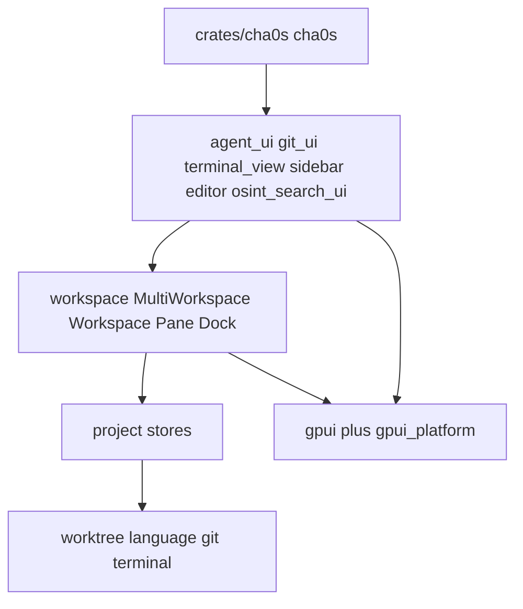
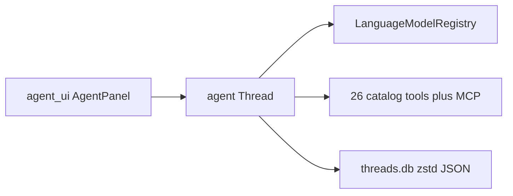

# CHA0S AOE — repository architecture

> Product version: **2.0.0** · verified against the code: **2026-10-13 UTC**
> Renewal rule: on any doc change, re-verify claims against the code and update both fields.

This file is the map of the code as it exists now: crates, startup, identities. It is not the product definition — see [PRODUCT.md](PRODUCT.md) for that; the code itself is the source of truth for both.

Companion documents (do not collapse these roles):

| File | Role |
| --- | --- |
| [PRODUCT.md](PRODUCT.md) | Product goals and their current implementation. |
| This file | Tree map. What is on disk. If this file and the code disagree, the code wins. |

Companion documents in the product repository: [README.md](../README.md) (product home), [CHANGELOG.md](../CHANGELOG.md), [ROADMAP.md](../ROADMAP.md), [SECURITY.md](../SECURITY.md), [LICENSE-NOTICE.md](../LICENSE-NOTICE.md).

Precedence of sources: the code is the source of truth; this file is a map of the code and is secondary to it — when they disagree, fix this file, never bend the code to match a document. [PRODUCT.md](PRODUCT.md) states what the product is and does today (goals and their current implementation); when the product must change, PRODUCT.md is updated first, then the code, then this file. Do not use crate READMEs or vendor markdown as facts about behavior.

Markers on this file: state of **this tree now**.

- ✅ working and verified
- ⚠️ probably works; unconfirmed — needs attention
- ❌ dead as of now (absent from the tree, or not what it claims to be)

The public product name is **CHA0S — Agentic Operations Environment**. Operator-facing copy uses **CHA0S** or the full category name. The macOS app is **CHA0S AOE.app** (`CHA0S AOE Dev.app` on the dev channel). Bundle id stays `ai.piniq.CHA0S`. CLI, URL scheme, environment variables, Nix package, and runtime directories continue to use `cha0s`/`CHA0S`. The app shell module is `app` (`crates/cha0s/src/app.rs`). Terminal `TERM_PROGRAM` is `cha0s`. There is no DAP: do not treat a DAP `client_id` as a live fact.

Git is a backup of this tree, not a product workflow (no PRs, no feature branches). The product's public repository is [CHA0S_AOE](https://github.com/cha0skvlt/CHA0S_AOE) — the product home (docs, releases, signatures, issues); the source tree's own remote is private. Two branches: **`dev`** — daily work; **`stable`** — etalon (live PTY, local/remote split, prod incident cycle). Promote to `stable` only when the etalon is updated.

---

## 1. Product identity

| Field | Value |
| --- | --- |
| Product | CHA0S — Agentic Operations Environment by piniq.ai |
| GUI binary | `cha0s` (`[[bin]]` in [crates/cha0s/Cargo.toml](crates/cha0s/Cargo.toml)) |
| CLI binary | `cli` (`crates/cli`), installed into the `.app` as `Contents/MacOS/cli` |
| Version | `2.0.0` (`crates/cha0s` package version) |
| Release channel file | [crates/cha0s/RELEASE_CHANNEL](crates/cha0s/RELEASE_CHANNEL) = `stable` |
| License | Closed source, EULA terms delivered with the product; no public source license. See [LICENSE-NOTICE.md](../LICENSE-NOTICE.md) |
| Public display name | `CHA0S` |
| macOS app | `CHA0S AOE.app` |
| URL scheme | `cha0s` |
| Compile-time name lock | `main.rs` module-scope `const _` assert: `paths::APP_NAME_LOWERCASE` equals `CARGO_BIN_NAME` |
| Git remote | private (source tree); public product home: [CHA0S_AOE](https://github.com/cha0skvlt/CHA0S_AOE) |
| Git branches | `dev` (daily) and `stable` (etalon). Git is a backup. No feature branches |

Bundle IDs from `crates/cha0s/Cargo.toml` metadata and [crates/release_channel/src/lib.rs](crates/release_channel/src/lib.rs):

| Channel | CFBundleIdentifier | CFBundleName |
| --- | --- | --- |
| Stable | `ai.piniq.CHA0S` | CHA0S AOE |
| Dev | `ai.piniq.CHA0S-Dev` | CHA0S AOE Dev |

[crates/paths/src/paths.rs](crates/paths/src/paths.rs): `APP_NAME = "CHA0S"`, `APP_NAME_LOWERCASE = "cha0s"`.

Native agent display id is `"CHA0S Agent"`. The Rust symbol is `CHA0S_AGENT_ID`.

### Runtime directories

macOS (default build):

| Kind | Path |
| --- | --- |
| Config | `~/.config/cha0s/` |
| Data | `~/Library/Application Support/CHA0S/` |
| Logs | `~/Library/Logs/CHA0S/` (`CHA0S.log`, `CHA0S.log.old`) |
| Cache/temp | `~/Library/Caches/CHA0S/` |
| State | `~/.local/state/CHA0S/` |
| Threads DB | `{data}/threads/threads.db` |
| Prompts DB | `{config}/prompts/prompts-library-db.0.mdb` (macOS uses config for prompts) |
| Themes (user) | `{config}/themes/` |
| Hang traces | `{data}/hang_traces/` |
| Payloads (observability JSONL) | `{data}/payloads/` — `paths::payloads_dir()`; `init_paths` **creates** it |
| DB | `{data}/db/` |
| Overlays (OSINT) | `{data}/overlays/` |
| OSINT page index | `{data}/osint_search/tantivy` |
| OSINT session | `{data}/osint_search/` (cookie/fingerprint store) |
| CEF cache | `{data}/cef/` (`--user-data-dir` included). One-time rename from a leftover legacy path on macOS/Linux. An empty destination is retried. |

Linux/FreeBSD: `$XDG_CONFIG_HOME/cha0s`, `$XDG_DATA_HOME/cha0s`, `$XDG_STATE_HOME/cha0s`, `$XDG_CACHE_HOME/cha0s` (Flatpak env overrides exist).

Windows: `%APPDATA%\CHA0S` (config), `%LOCALAPPDATA%\CHA0S` (data/state/cache).

`--user-data-dir` calls `paths::set_custom_data_dir`; config then becomes `{custom}/config`.

Project overlay folder name: `.cha0s`. Relative files: `.cha0s/settings.json`, `.cha0s/tasks.json`. Also reads `.vscode/tasks.json`. **No** `.cha0s/debug.json` path helper.

User config files under config dir: `settings.json`, `keymap.json`, `tasks.json`, `AGENTS.md`. **No** `debug.json`.

`init_paths()` in `main.rs` creates: config, languages, database, logs, temp, hang_traces, **payloads**.

### Platform support status

| Platform | Status |
| --- | --- |
| macOS | ✅ primary development and delivery target; all live acceptance is on macOS |
| Linux | ✅ crates and bundle scripts in tree (`gpui_linux`, `script/bundle-linux`); not operator-accepted in this cycle |
| Windows | ❌ **frozen — not supported, not a target.** Windows trees (`gpui_windows`, `etw_tracing`, `explorer_command_injector`, `windows_resources`, `script/bundle-windows.ps1`, `script/test-wsl-sandbox.ps1`) exist in the tree but are dormant. No builds, no fixes, no acceptance. Windows-only code paths (WSL sandbox helper provisioning) are dead on this freeze |

### Naming conventions

New code uses `cha0s` / `CHA0S_*` only. `CHA0S_*` is the product name.

---

## 2. Repository tree

```
CHA0S AOE source tree (private)
├── README.md                product intent; not a map of the tree
├── EULA.md                  sole terms for the sold product
├── Cargo.toml               workspace (default-members = crates/cha0s)
├── Cargo.lock
├── Makefile                 macOS targets only
├── rust-toolchain.toml      1.97.1
├── rustfmt.toml
├── clippy.toml
├── .prettierrc
├── .gitignore               local junk; source remote is private
├── .cargo/config.toml       rustflags, cargo aliases, MACOSX_DEPLOYMENT_TARGET
├── .config/nextest.toml
├── flake.nix                nix flake-parts
├── flake.lock
├── default.nix
├── shell.nix                flake-compat
├── docs/                    product documentation set (PRODUCT, ARCHITECTURE, DB, LOGS, TESTS, TODO, LLM)
├── assets/                  fonts, icons, images, keymaps, osint, prompts, settings, themes
├── crates/                  first-party + vendored
├── nix/                     modules, tests, dev flake
├── script/                  build/bundle/lint helpers
├── tooling/                 lints (not a member), perf (member)
└── target/                  cargo output
```

No `extensions/` workspace members.

---

## 3. Build and toolchain

`rust-toolchain.toml` (private tree): channel `1.97.1`, profile `minimal`, components `rustfmt`, `clippy`, `rust-analyzer`, `rust-src`. `targets = []` — no first-party member builds for extra targets.

`Makefile` (private tree, macOS): `CXXFLAGS=-stdlib=libc++`, `CARGO_TARGET_DIR=$(ROOT)/target`.

| Target | Action |
| --- | --- |
| `make build` | `script/build-macos --build-only` |
| `make install` | `script/build-macos` (build + `/Applications/CHA0S AOE.app`) |
| `make install-only` | pack already-built binary |
| `make open` | `open -a "CHA0S AOE"` |
| `make check` | `cargo check -p cha0s --offline` |
| `make check-p C=<crate>` | `cargo check -p $(C) --offline` (default `C=cha0s`) |
| `make build-p C=<crate>` | `cargo build --release -p $(C) --offline` |
| `make test` | one run, `TEST_ENV`=`SEED=0 ITERATIONS=1 PROPTEST_SEED=0 TZ=UTC LC_ALL=C LANG=C`, `--locked --no-fail-fast -- --test-threads=1`: `--workspace --lib --tests --bins --examples`. Doctests are not in the pyramid |
| `make test-p C=<crate>` | pointed tests, same `TEST_ENV` |
| `make field` | short field barrel, same `TEST_ENV`, no CEF `live_`: agent lock/PTY/tools, OpenRouter cheap+vision, boot/keymaps, paths/session/clock/tls, recent_projects, osint_search `tab_label`/`normalize`, title_bar, `cha0s_actions`, `json_schema_store`. This machine: **134 s** (2026-09-19, `real 133.76`) |
| `make gate` | `cargo check -p cha0s` → release build `-p cha0s -p cli` → two batched `cargo test` runs (library and binary-only packages) for first-party crates named by `crates/<name>/` in `git diff HEAD` **and** untracked files. Missing `Cargo.toml` is skipped; `live_` is excluded. Batching prevents feature-set cache thrash from one Cargo invocation per crate. No crate diff → check+build only. Rebuild (`patch` / `install-only`) only after green gate |
| `make cef` | `cargo test -p browser --lib live_ -- --ignored`. Not gate. |
| `make kb` | ignored `live_` suite of `kb`. Needs local Postgres. Not gate. |
| `make patch` | `script/dogfood` (detached: quit CHA0S → gate → pack `.app` → relaunch) |
| `make reload` | `script/build-macos --install-only --open` |
| `make smoke-access` | `script/smoke-access-boot` on the release binary |
| `make uninstall` | `script/build-macos --uninstall` |
| `make clean` | `cargo clean` |
| `make backup` | `script/backup` |
| `make keys` | `license-keygen keygen --out KEYFILE` (default `~/.config/cha0s/license.key`, mode 0600, outside the repo). Prints the public hex. Refuses a path inside the repo and refuses to overwrite. |
| `make license` | `license-keygen sign --plan PLAN` (`demo` 3d, `month` 30d, `quarter` 91d, `year` 365d). Prints `CHA0S-1.…` |
| `make license-inspect` | `license-keygen inspect KEY=…` — payload only, no private key |
| `make keys-test` | keygen unit tests; if `KEYFILE` exists, also verifies mode 0600 and its public half against embedded `PUBLIC_KEY` |

Do not launch `target/release/cha0s` as the Mac app. Launch Services treats that unix exec as a second application. Use the `.app`.

`install-macos-app` derives app name and bundle id from the same `RELEASE_CHANNEL` source as the binary. CEF helpers link the parent framework with an in-bundle relative symlink; packaging fails if strict deep code-sign verification fails.

Platform crates exist for Linux and Windows (`gpui_linux`, `gpui_windows`, `script/bundle-linux`, `script/bundle-windows.ps1`, `script/freebsd`). The Makefile path used in this repo is macOS-only. Windows is frozen (see Platform support status in §1); Linux is in-tree but not accepted.

`.cargo/config.toml`: `-C symbol-mangling-version=v0`, `--cfg tokio_unstable`, `MACOSX_DEPLOYMENT_TARGET=10.15.7`. Aliases: `perf-test`, `perf-compare`.

### script/

| Path | Role |
| --- | --- |
| `script/build-macos` | Release build + install/uninstall `.app`; after pack runs `osint_prefetch` (best-effort, skip if offline) |
| `script/bundle-cef-macos` | Pack CEF helpers into the `.app` |
| `script/install-macos-app` | Pack binaries into `/Applications/CHA0S AOE.app` |
| `script/macos-env` | macOS env for builds (`CXXFLAGS`, target dir) |
| `script/bundle-linux` | Linux bundle |
| `script/bundle-windows.ps1` | Windows bundle |
| `script/bundle-freebsd` | FreeBSD bundle |
| `script/install-linux` | Linux install |
| `script/install.sh` | Unpack Linux archive into `~/.local` |
| `script/linux` | Linux helper |
| `script/freebsd` | FreeBSD helper |
| `script/clippy` | Clippy |
| `script/clippy.ps1` | Clippy (Windows) |
| `script/cargo` | Cargo wrapper |
| `script/check-keymaps` | Keymap check |
| `script/dogfood` | Detached rebuild loop from inside CHA0S: quit → gate → pack `.app` → relaunch → notification; invoked by `make patch` |
| `script/get-crate-version` | Crate version helper |
| `script/get-crate-version.ps1` | Crate version helper (Windows) |
| `script/update-json-schemas` | JSON schema update |
| `script/new-crate` | New crate scaffold |
| `script/prettier` | Prettier |
| `script/debug-cli` | CLI debug |
| `script/metal-debug` | Metal debug |
| `script/verify-macos-document-icon` | Document icon check |
| `script/install-cmake` | CMake install helper |
| `script/install-rustup.ps1` | rustup on Windows |
| `script/uninstall.sh` | Uninstall helper |
| `script/backup` | Tree backup helper |
| `script/smoke-access-boot` | Access-door boot smoke (no GUI rebuild) |
| `script/render-macos-app-icon.py` | Render macOS `.app` icon PNGs from source art |
| `script/test-wsl-sandbox.ps1` | WSL sandbox test |
| `script/flatpak/` | `bundle-flatpak`, `deps`, `convert-release-notes.py` |
| `script/lib/workspace.ps1` | PowerShell workspace helpers |

### nix/

The root `flake.nix` (private tree) uses flake-parts; systems `x86_64-linux`, `x86_64-darwin`, `aarch64-linux`, `aarch64-darwin`. Imports `nix/modules/{overlays,packages,partitions}.nix`. Package output `cha0s` (`pname = "cha0s"`, `mainProgram = "cha0s"`); Linux install paths `$out/bin/cha0s`, `$out/libexec/cha0s`, desktop `ai.piniq.CHA0S.desktop`. [nix/dev/flake.nix](nix/dev/flake.nix) is a nested dev flake. Tests: `nix/tests/a11y.nix`, `nix/tests/sandboxing/`.

---

## 4. Cargo workspace

`Cargo.toml` (private tree):

- resolver `2`
- `default-members = ["crates/cha0s"]`
- `workspace.package.publish = false`, `edition = "2024"`
- **174 members** (172 top-level `crates/*` + `crates/refineable/derive_refineable` + `tooling/perf`). Members include `observability`, `kb`, `agent_skills`, `gpui_shared_string`, `etw_tracing`. `project` / `fs` / `worktree` lib unit tests are enabled (`test = true`)
- **21 exclude** vendored trees (per-tree inventory with licenses stays in the private tree)
- `[patch.crates-io]`: `async-process`, `async-task`, `calloop` → `crates/…`; `notify`, `notify-types` → `crates/notify-rs/…`
- Profiles: `dev`, `dbg`, `release` (`lto = false`, `codegen-units = 16` — local operator install; no per-package `cha0s` override), `release-lto` (inherits `release`, thin LTO, cg=1 — delivery), `release-fast` (inherits `release`, `debug = "full"`)
- `tooling/lints` is **not** a member. `[workspace.metadata.dylint]` points at it; it pins its own nightly in `tooling/lints/rust-toolchain.toml`

Lib convention: most crates use `src/{crate_name}.rs`. `src/lib.rs` exceptions: `browser`, `cha0s_actions`, `languages`, `media_player`, `observability`, `sqlez`, `gpui_util`, `release_channel`, `ztracing`, `ztracing_macro`, `perf`. Root-level lib files: `agent_skills/agent_skills.rs`, `gpui_shared_string/gpui_shared_string.rs`, `etw_tracing/etw_tracing.rs`. `cha0s` has no lib.

Bins:

| Crate | Bin | Path | Notes |
| --- | --- | --- | --- |
| `cha0s` | `cha0s` | `src/main.rs` | default-run |
| `cha0s` | `cha0s_visual_test_runner` | `src/visual_test_runner.rs` | feature `visual-tests` |
| `cli` | `cli` | `src/main.rs` | also a lib |
| `osint_search` | `osint_prefetch` | `src/bin/prefetch.rs` | overlay prefetch helper |
| `sandbox` | `bwrap_test_helper` | `src/bwrap_test_helper.rs` | feature `nixos-test` |
| `sandbox` | `wsl_sandbox_test_helper` | `src/wsl_sandbox_test_helper.rs` | feature `wsl-test` |
| `perf` | `perf` | `src/main.rs` | also a lib (implicit bin) |

Proc-macro crates: `feature_flags_macros`, `gpui_macros`, `derive_refineable`, `settings_macros`, `sqlez_macros`, `ui_macros`, `util_macros`, `ztracing_macro`.

---

## 5. Layers and data flow



One OS window = `MultiWorkspace` containing one or more `Workspace` values. Each `Workspace` has a `Project`, three `Dock`s (left/bottom/right), status bar, modals, and **five exclusive center lanes** (`CenterLane`: Editor / Browser / Log / Search / Console). One visible `PaneGroup` at a time; the others sit in `parked_lanes`. `add_item` routes by item kind (`switch_lane` then insert). Session serialize writes the **editor** lane only (`editor_lane_root`). `CenterMode` remains as a thin alias (`lane_of_mode` / `show_center_preserving_docks`). Threads is a left-dock panel (`persistent_name` / `panel_key` `"threads"`, `activation_priority` 1 next to Agent 0) inside `#workspace`. Title bar and status bar span the window width. `SessionTabStrip` entity stays alive; the title bar does not render it (parked; revive `.child(self.render_session_tabs(cx))` in `title_bar.rs`). Title-bar right: `SystemStatus` (clock `HH:MM`, date `DD-MM-YYYY`, default-route IPv4; one click masks all three).

Product default is Cursor-style: each project is its own OS window. `default_open_behavior` / `cli_default_open_behavior` = `new_window` (empty current window is reused). File → New Window / Open / Open Recent and `cha0s <dir>` open another window. Add Folder to Project still appends a folder to the current window. `restore_on_startup` = `last_session` reopens every window from the previous quit: project paths, tabs, docks, bounds, sidebar. Persistence: `workspaces.session_id` + `workspaces.window_id` + KVP `session_window_stack` / `multi_workspace_state`. Restore: `restore_or_create_workspace` → `last_session_workspace_locations` → `read_serialized_multi_workspaces` → `restore_multiworkspace` per window.

Text pipeline:

```
Worktree
  -> project::BufferStore opens language::Buffer (rope + tree-sitter via language/grammars)
  -> editor edits multi_buffer::MultiBuffer (one or more excerpts)
  -> editor::display_map (fold/wrap/inlay/tab) -> EditorElement
```

`SerializedWorkspaceLocation` in restore is `Local` only ([crates/cha0s/src/main.rs](crates/cha0s/src/main.rs) `restore_or_create_workspace`).

Project stores in [crates/project/src/](crates/project/src/): `worktree_store`, `buffer_store`, `git_store`, `task_store`, `agent_server_store`, `context_server_store`, `bookmark_store`, `image_store`, `toolchain_store`, `trusted_worktrees`. No `color_extractor`. `environment` is a private mod.

`DisableAiSettings` is live (`disable_ai` in settings, OR-merge, used by agent UI, title bar, context servers).

No language servers: no `Editor::lsp_data_enabled`, no `Project` `language_server*` methods. Buffer diagnostics UI lives in `editor::diagnostics` (renderer trait), not a `diagnostics` crate. Language configs and tree-sitter grammars are live.

---

## 6. Startup sequence

Entry: [crates/cha0s/src/main.rs](crates/cha0s/src/main.rs). Platform: `gpui_platform::current_platform` (macOS → `gpui_macos` + Metal `gpui_apple`).

### Before `app.run`

1. `sandbox::run_sandbox_launcher_if_invoked()`
2. `browser::boot_cef_subprocess()` — CEF helper processes re-enter this binary with `--type=…`; must run before clap
3. `util::prevent_root_execution()` (unix)
4. Clap `Args` (early exits: askpass, crash_handler, ETW, `--printenv`, `--dump-all-actions`)
5. `paths::set_custom_data_dir` if `--user-data-dir`
6. Windows only: `util::get_cha0s_cli_path()` → `askpass::set_askpass_program`
7. `init_paths()` — create config / languages / db / logs / temp / hang_traces / **payloads**
8. `observability::init` — `CHA0S.log` (+ stdout if PTY), `{data}/payloads/` JSONL, Prometheus `/metrics` on `127.0.0.1:9464` unless `CHA0S_METRICS=0` (`CHA0S_METRICS_PORT` overrides port). Producers use a bounded non-blocking disk queue: overload drops only the disk job, increments `cha0s_observability_io_dropped_total`, and never stalls UI/tool paths. Payload retention pruning is amortized by rotation/new trace/byte interval instead of scanning the directory per event; explicit flush remains a bounded guaranteed control path.
9. `--system-specs` exit (after paths + observability; uses `AppVersion`)
10. Rayon pool
11. `build_application().with_assets(Assets)` (`CHA0S_EXPERIMENTAL_A11Y=1` → accessible platform)
12. `db::AppDatabase`, `first_run_is_new` (boolean `first_run_seen`), `Session`
13. Single-instance check (macOS `app::mac_only_instance`; Linux CLI-socket; Windows named instance). **Skipped** when `CHA0S_STATELESS` or `ReleaseChannel::Dev`
14. `crashes::init` spawned in background (no “send report” UI); the `CrashHandler` global is set inside `app.run`
15. `RealFs`, keymap file watcher, login-shell env (unix, non-PTY)
16. URL / reopen handlers

### Inside `app.run` (order)

1. `cx.set_global(app_db)`
2. `WorkspaceDb::fetch_trusted_worktrees` → `trusted_worktrees::init(db_trusted_paths, cx)`
3. `menu::init`
4. `cha0s_actions::init`
5. `release_channel::init(app_version, cx)`
6. `gpui_tokio::init`
7. spawn: await `crashes::init` → `cx.set_global(CrashHandler(client))`
8. `AppCommitSha::set_global` if built with sha (`CHA0S_COMMIT_SHA`)
9. `settings::init`
10. `zlog_settings::init`
11. `app::watch_settings_files`
12. `handle_keymap_file_changes`
13. HTTP `ReqwestClient` with empty user-agent → `cx.set_http_client`
14. `Fs::set_global`
15. `GitHostingProviderRegistry` + `git_hosting_providers::init`
16. `OpenListener::set_global`
17. `Client::production` (replaces the HTTP client)
18. `LanguageRegistry` + `ui::on_new_scrollbars::<SettingsStore>`
19. `languages::init` (no Node)
20. `WorkspaceStore`
21. `Client::set_global`
22. `app::init`
23. `app::move_to_applications::init` (macOS)
24. `project::Project::init`
25. `feature_flags::FeatureFlagStore::init` (local only; no cloud flag feed)
26. `block_on(first_run)`, `block_on(session)`, `AppSession::new`
27. `AppState` global
28. `reliability::init` (local hang/memory logs; no HTTP)
29. `theme_settings::init`, eager theme load (bundled `assets/themes/` + user JSON; no extension host)
30. `command_palette::init`
31. `language_model::init`
32. `language_models::init` (registers providers; no outbound until operator uses a cloud key or Ollama localhost)
33. `maybe_init_browsing` — only if `agent.browsing`; then `web_search::init` + `web_search_providers::init` (DuckDuckGo). Re-checked on SettingsStore observe
34. `osint_search::init` (registry; OverlayManager can pull Tor/i2pd/Kubo later)
35. `browser::register_clearnet_bridge` — live pump, `LiveControl`, clearnet fetch bridge, **`register_browser_audio_mute`**
36. `agent_ui::init(fs, languages, is_new_install, false, cx)`
37. `app::watch_user_agents_md`
38. `recent_projects::init`
39. `load_embedded_fonts`
40. `editor::init`, `image_viewer::init`, `media_player::init`
41. `workspace::init`
42. `title_bar::init`, `ui_prompt::init`
43. Panel inits: `go_to_line`, `file_finder`, `tab_switcher`, `outline`, `project_panel`, `outline_panel`, `search`, `PaneSearchBarCallbacks` (`BufferSearchBar`), `terminal_view`, `journal`, selectors, `language_tools`, `git_ui`, previews, `onboarding`, `settings_ui`, `keymap_editor`, `inspector_ui`, `json_schema_store`, `miniprofiler_ui`, `which_key`, `etw_tracing` (Windows).
44. `observe_global::<SettingsStore>` (window appearance, text rendering, `maybe_init_browsing`); `load_user_themes_in_background`; `watch_themes`; `watch_languages` (debug); `app_menus` / `set_menus`
45. `initialize_workspace` — registers workspace items; constructs `Sidebar` on `MultiWorkspace` and `workspace.add_panel` as left dock `"threads"`; attaches OSINT browser; fills the status bar ([crates/cha0s/src/app.rs](crates/cha0s/src/app.rs))
46. `cx.activate`; open URLs / diffs; spawn `restore_or_create_workspace`; workspace GC after restore
47. `component_preview::init`

`initialize_workspace` status bar ([crates/cha0s/src/app.rs](crates/cha0s/src/app.rs)):

- Left: left-dock `PanelButtons` (Agent then Threads), `ActiveFileName`, `GitBlameStatus`, `MergeConflictIndicator`, `ActivityIndicator`. The agent lock is not here.
- Center (`workspace::status_bar`): Editor / Console / Browser / Logs / Search. Console: one click = `CenterLane::Console` (after 220 ms `DoubleClick`); two clicks = bottom `TerminalPanel` peek without changing the focused lane. Other type buttons toggle that lane vs Editor.
- Right: `AudioIsolateButton`, `AccessLockButton` (key), `LicenseKeyStatus` (`key: Nd`, `key: expired` in red), encoding / language / toolchain / line-ending / cursor, `ImageInfo`

Clock and IP are **not** status-bar items. `osint_search_ui::attach_to_workspace` runs before the status-bar fill.

View menu ([crates/cha0s/src/app/app_menus.rs](crates/cha0s/src/app/app_menus.rs)): Editor (`ShowCenterEditor`), Console (`ToggleCenterDock`), Browser (`ToggleCenterSearch`), Logs (`ToggleCenterLog`), Search (`ToggleCenterProjectSearch`), Threads (`ToggleWorkspaceSidebar`). Plus-menu empty cell: `New Console` (`NewCenterTerminal`). Help: Briefing.

`Client::production` wraps the HTTP client for Ollama / OSINT / BYOK. No `ClientSettings.server_url`, no `sign_in` / `connect` / `Peer` / `UserStore`. No `client::urls`, no `llm_token` / `RefreshLlmTokenListener`.

### Access door

`workspace::access` is a modal door on a fully booted session, not a boot stopper. `workspace::init` calls `access::init`, then `license_gate::init`. If required/locked or first-open briefing is pending, `present_access_gate_on_windows` / `present_briefing_gate_on_windows` walk every window through `present_on_handle` (MultiWorkspace closes the sidebar when locking). `AccessGate`: opaque background, screen-centered (`ModalLayer` `size_full().justify_center()`). Passphrase is Argon2id (19 MiB, t=2, p=1) in KVP key `access_password_sha256` (the name stayed so an old install still loads). The value is a PHC string. A stored unsalted SHA-256 still unlocks once, then is replaced. `CHA0S_ACCESS_PASSWORD` compares in the clear and does not rewrite the stored hash. Hint has no user name and no word `access`. Briefing copy: not for vibe coders. `lock_ide` = `lock_access` then `cx.defer(present_locked_briefing_on_windows)`. Key: `workspace::DoubleClick` 400 ms (`click_count >= 2` or two `click_count=1`). Locked session refuses `toggle_access_required`.

`license_gate` does not look at the release channel. A missing, expired, or tampered key opens Briefing with a key field and blocks dismiss. The check is local Ed25519 (`license` crate, public key in the binary). No key server, no HWID. The re-check timer wakes at expiry, otherwise hourly. Expiry opens that same hard Briefing in the running session. Briefing always shows the key's day line. There is no 7/3/1 toast. The status-bar counter stays, with a gray bar on each side. A key that no longer loads opens the hard gate. A successful Apply reports the key just accepted and shows that same key on the Briefing line and the status counter before the KVP write lands. The hour tick repaints both. The private key stays outside the repo (`tooling/license-keygen` is not a workspace member).

### Shared double-click

`workspace::DoubleClick` / `ClickKind` — one contract for the Access key (400 ms) and the Console status button (220 ms). Token `take_single` cancels a pending single after a double.

### Center chrome and splits

Center tab chrome is `Pane::render_tab` plus `default_render_tab_bar_buttons` (gold Editor chrome). Plus-menu empty cell: New File / Open File / Search Project / New Terminal / **New Console** (`NewCenterTerminal`) / New Browser Tab. Split buttons: `Split` (2) and `SplitQuad` (4). Click emits `pane::Event::SplitCenterGrid { cells }` — the same deferred-event pattern as `Event::Split`. `Workspace::handle_pane_event` calls `Workspace::split_center_grid`. Empty-cell kind = the active tab's kind (`BlankKind`). Production seed is pane-targeted: `SeedBlank` factories registered from `editor::init` (`Editor::new_file_in_pane`), `osint_search_ui::attach_to_workspace` (`about:blank`), `search::init` (`ProjectSearchView::new_search_in_pane`), `terminal_view` (`TerminalView::seed_blank_in_pane`). Log has no factory; `seed_blank_in_pane` constructs `LogPanel` and `add_item`s it into the **specified** pane. Tests without factories fall back to `TestItem`. Do not seed by deferred `dispatch_action(NewFile)` — that piles blanks onto the source pane.

### Entity lease

GPUI `Entity` is single-lease. `read` / `update` on an already-leased entity is `double_lease_panic` (SIGABRT). All `PanelHandle` **read** methods use `try_read` (defaults: position Left, size `px(240)`, toggle `NoAction`, focus `cx.focus_handle()`). `Workspace::fallback_focus_handle` `try_read`s docks and the active pane, else Workspace `focus_handle`. Threads: `activate_thread_locally`, `create_new_thread`, preview/confirm switcher, and `cycle_project_impl` go through `window.defer` / `defer_activate_workspace` so Sidebar is not leased when docks are read.

---

## 7. Settings merge

```
assets/settings/default.json          (SettingsAssets embed)
  -> language_settings slot           (languages feed language settings here)
  -> global_settings slot             (SettingsStore field, no cloud feed)
  -> ~/.config/cha0s/settings.json    (user content + for_release_channel() + for_os())
  -> active settings profile          (profile.settings, if selected)
  -> server_settings slot
  -> .cha0s/settings.json             (local stack: parent dirs then child)
```

EditorConfig is a separate `EditorconfigStore`, not the same JSON merge chain. `disable_ai` OR-merges from every local/project file into the global value.

There is no WASM extension host. The `language_settings` field in `SettingsStore` is a merge slot.

Schema id: `cha0s://schemas/settings`. `base_keymap` default `"CHA0S"` (`settings_content`). Keymaps: the six root keymap JSON files under `assets/keymaps/`.

[crates/settings/src/settings.rs](crates/settings/src/settings.rs) `SettingsAssets` RustEmbed: `settings/*`, `keymaps/*`.

Default keymap path by OS: `keymaps/default-macos.json` / `default-linux.json` / `default-windows.json`.

Crates: `settings_content` (serde schema), `settings` (`SettingsStore`), `settings_json`, `settings_macros`, `migrator` (tree-sitter keyed migrations), `settings_ui`, `keymap_editor`, `settings_profile_selector`, `json_schema_store`.

---

## 8. Agent runtime



ACP: `agent_client_protocol` (crates.io) + `acp_thread` (native session; trait `AgentServer` lives here). Native server: `NativeAgentServer`. Foreign agent servers, npx agents, and registries are not part of CHA0S; `CompletionIntent` has no `Subagent` and there is no `subagent_model` setting.

Turn stop: any completion round that ends without a tool call is the model's debrief and ends the turn immediately, surfacing the text. There is no work-nudge loop — the agent is never re-prompted to "keep working". While `solo` is idle that return is unchanged. A running solo cycle treats the same tool-free round as a segment boundary: it appends `Message::SoloPrompt` (service user text prefixed `Solo cycle.`) and continues the same turn. After the cycle has ended, those prompts stay in the thread and are omitted from the model request. One line is appended after the operator's latest message: the standing order is cancelled, and that latest message is the only order. If the operator has turned the moon off, that boundary and the boundary after tools end the cycle as `OperatorStopped` and append no continuation. `Message::Nudge` from old thread data is never sent back to the model. `end_turn_at_next_boundary` is one-shot (cleared when honored). Every tool is loop-guarded: three identical executions are allowed, the fourth is refused, and repeating a refused call ends the turn (`TOOL_LOOP_END_TURN_AFTER = 2`). In a solo cycle the fourth identical call closes that tool for the rest of the cycle: the refusal is one card, the tool leaves the next request, and the other tools stay. Three error results close that tool the same way. The cycle does not end. A console read of one tab is the key `terminal:read`. Poll fields and the `cmd` / `action` aliases do not open another read of that screen. A different tab is a different screen. The second read of a tab does not run and does not close `terminal`. A read that errors does not hold the screen. One card shows the refusal. A successful `op=run`, `op=kill`, or `op=new_tab` on that tab allows one later read of it. Other calls do not. The first batch that is only that refusal continues the cycle once. The next such batch stops the turn and leaves the cycle running. URL/search keys catch interleaved repeats. `logs` keys normalize tab/level aliases, case, and numeric strings while omitting cursor/page-size/wait, so one filter cannot chase a live ring past three pages.

Solo cycles live on the thread (`crates/agent/src/solo.rs`), not in a second runtime. The moon is a switch on the open thread. It does not start the cycle: the send arrow does, and only while the moon is on. That message is the instruction. The button does not create a thread or choose own versus task. Start snapshots reflection tool, approval queue, filesystem lock, and tool permissions from settings. The default budget is 0 for wall clock, tool calls, and tokens, and 0 means no limit: the cycle runs until the moon is turned off. The cycle token counter is input plus output after start, not cache tokens and not `cumulative_token_usage`. `send` refuses while the cycle is running or paused. The moon is blue only while the switch is on. Moon off sets `stop_at_boundary`. The in-flight reply or tool is not aborted. At the next boundary the engine injects one debrief, and that report ends the cycle as `OperatorStopped`. A click while paused, or during provider recovery, ends immediately with no report round. `cancel` while a turn is in flight is the Stop button and records `OperatorStopped` before abort. A click while paused ends the cycle immediately. Provider retries that still fail keep the cycle running. A transient failure waits 5 minutes, then 30 minutes, and the third ends it as `Provider` with one `Solo ended.` line and no model debrief. Fatal provider errors end on the first. A model refusal still pauses without truncating the thread. The `db` tool is not queued: it only runs one `SELECT` and refuses anything else itself. One profile holds one cycle; the slot drops with the scheduler. A process restart rewrites a live cycle to `Ended(Quit)` and emits `SOLO_END` only after that blob is saved. Events: `SOLO_START` 1017, `SOLO_SEGMENT` 1018, `SOLO_END` 1019.

Read-guard (`note_recon` in `thread.rs`): 12 consecutive lookup tools with no other tool in between nudge the model; the next lookup ends the turn. Re-reading the same target (`recon_target_key` = tool + path/query) does not grow the streak; any non-lookup tool resets it. The stop text carries the way out: run one non-lookup tool to reset the counter.

Persistence: SQLite `{data}/threads/threads.db`, table `threads` (`id`, `summary`, `updated_at`, `data_type`, `data` blob = compressed JSON). Not a vector DB.

Cloud privacy: `cloud_privacy::CloudPathAlias` rewrites worktree/home paths to generic aliases on outbound LLM requests and back on inbound (`thread.rs`). Live wire-privacy contour (no real paths on the wire).

Templates in `crates/agent/src/templates/`: `system_prompt.hbs`, `edit_file_prompt_xml.hbs`, `edit_file_prompt_diff_fenced.hbs`, `create_file_prompt.hbs`, `diff_judge.hbs`. `SystemPromptTemplate` fields that the prompt reads: `available_tools`, `profile_prompt`, `local_fs_lock`, `hide_host_identity`, project/rules/skills. There is no Plan/Debug mode block and no unused `sandboxing` / `is_linux` / `is_windows` payload.

### Profiles

Built-in in [crates/agent_settings/src/agent_profile.rs](crates/agent_settings/src/agent_profile.rs): only `write` (screen name Agent). Built-in ids resolve at `Thread::new` / `from_db` / `set_profile` / `enabled_tools` / `default_profile`. Default `"default_profile": "write"`. Custom profiles: `system_prompt` (inline), `system_prompt_file` (path; missing file refuses the turn), `kb_url` (optional DSN; a non-empty profile `kb_url` wins over the `agent.databases` registry). The profile card in `ManageProfilesModal` edits the name, the system prompt (inline text or a file path; Confirm clears the other key), and `kb_url`. Screens are `RenameProfile`, `ConfigureSystemPrompt`, and `ConfigureKb` in the same modal. Builtin `write` takes system-prompt writes. Its name and `kb_url` stay locked. The tool map stays in `system_prompt.hbs` and is sent with every profile; it is not stored in settings and not shown on the card. When `write` has no `system_prompt` key and no prompt file, the factory character is filled in memory. A saved empty string stays empty. A new profile and a fork of `write` start with an empty `system_prompt`. A fork of a custom profile copies that profile's prompt and `kb_url`. Card suffixes are `inline` / `file: <path>` / `empty` and, for the database, `host:port/db` when `kb_url` is set, else `registry` / `default`. A missing prompt file is noted once when the card opens (`file: <path> · missing`). The raw DSN stays off the card row. `ManageProfiles.customize` deep-links a section and wins over `customize_tools`. Empty `tools` = all 26 `BUILTIN_TOOL_NAMES`, including `database`, `wait`, and `solo`. Non-empty `tools` = closed allowlist.

From [assets/settings/default.json](assets/settings/default.json):

| Profile | Tools |
| --- | --- |
| write (Agent) | empty map = catalog of 26 names, including `database`, `wait`, and `solo` |

`enable_all_context_servers`: false on write.

A call to a missing tool gets `missing_tool_error_message` (name + offered list), not a silent skip.

Default model: `{ "provider": "ollama", "model": "qwen" }`.

Hybrid lock = sandbox switch. Setting `local_fs_lock` (default `true` in `default.json`). The padlock sits in the agent footer, to the right of Database: `crates/agent_ui/src/local_fs_lock_button.rs` (`LocalFsLockButton` → `toggle_local_fs_lock` / `update_settings_file`; no `dispatch_action`). `SoloButton` (`solo_button.rs`, moon icon) sits immediately after the padlock and hides when `agent.solo.enabled` is false. The status bar does not host it. Right-hand group: `AudioIsolateButton` (KVP `media.audio_isolated` → CEF mute), `AccessLockButton` (launch-required toggle / double-click `lock_ide`). Clock+IP live in title-bar `SystemStatus`, not here. Runtime gates `sandboxing_enabled` / `sandboxing_enabled_for_project` return **`AgentSettings.local_fs_lock`**. `sandboxing_available_for_project` is platform-only (`macos` / `linux`). A model-requested `unsandboxed: true` while locked is rejected. Search tools and `fetch` ignore the filesystem lock; `fetch` always keeps its independent SSRF gate. `search_web` is gated by `agent.browsing`; `kb` is gated by `agent.kb_enabled`. `sandbox_permissions` is engine-internal (defaults, not a `default.json` pulpit).

`disable_ai`: false. `context_servers`: `{}`. `enable_feedback`: false. `kb_enabled`: true, `databases`: `{}` (name → `{ dsn, schema? }`), `kb_active`: null (name of the active registry entry). A non-empty profile `kb_url` wins over that name. `document_max_pages`: 20 (zero or a missing key is also 20).

`read_file` sends PDF, OOXML (docx, xlsx, pptx), EPUB, ODT, RTF, and archive listings through `document_extract` on the background executor, after the image branch and before `open_buffer`. A skill path and an unlocked path outside the project use the same extractor once that path is already authorized. Extension wins over ZIP magic, so a `.docx` stays a document. `archive::member` reads one member in memory. Declared uncompressed size is capped at 32 MiB before allocation, including xlsx before calamine parses; text handed to the model is capped at 256 KiB. A PDF with no text layer is the error `no text layer` and no image. A session read of those files is base64 with the same 256 KiB ceiling. The editor, worktree, and project search keep `Pdf`, `ZipContainer`, and `Tar` out of the rope via `ByteContent::opens_as_text`. The UI preview is `pdf_preview` (`.pdf` only), registered next to csv, and it uses the same `document_max_pages` cap.

### Built-in tools (`tools!` in [crates/agent/src/tools.rs](crates/agent/src/tools.rs))

26 names (`ALL_TOOL_NAMES` in `tools.rs`; the smoke test asserts `len() == 26`): `copy_path`, `create_directory`, `create_plan`, `db`, `delete_path`, `edit_file`, `fetch`, `browser`, `find_path`, `grep`, `actions`, `logs`, `open_url`, `settings`, `state`, `kb`, `list_directory`, `move_path`, `read_file`, `skill`, `solo`, `terminal`, `search_clearnet`, `search_onion`, `search_i2p`, `search_web`, `write_file`.

Construction of a live session is two steps, not two catalogs. `tools!` is the type passport (names, schemas, permission UI). `Thread::add_default_tools` plants 26 of those names plus the internal `sandboxed_terminal` variant, including `solo`. It does **not** plant `skill` (smoke `smoke_add_default_tools_registers_catalog`). `NativeAgent` then `add_tool(SkillTool::with_body_resolver(...))` so the resolver reads `state.skills` at invoke time. Before a request, terminal/search/browser/document backends are grouped into `terminal`, `search`, `browser`, and `documents`; `actions` remains exposed for verified pane/focus/action dispatch. The model-facing set (`present_model_tools`) additionally drops `search_web`, `kb`, and `db` from the offered list and folds `terminal` + `console_pane` into one face named `terminal`. Tests that need the full catalog without NativeAgent attach their own resolver after `add_default_tools`.

Run path wraps every tool in `ToolOutcome` (`ok` / `error { code, message, retryable }`). Codes: `invalid_args`, `permission_denied`, `timeout`, `transport`, `state_changed`, `tool_error`. Deadline: `agent.tool_timeout_ms` default 120000 (`ToolDeadline`). The deadline capability is carried by each `ToolInput` and preserved through typed casts, model-facing delegates, MCP, and settings tools; no async/thread-local deadline scope exists. Autoretry only idempotent names (`read_file`, `grep`, `find_path`, `list_directory`, `state`, `logs`) when `retryable`. `actions` resolves `cha0s_actions::resolve_action`. `state` returns YAML from `workspace::ide_snapshot`. `terminal` forwards timeout/background/kill/output-selection controls; `search` forwards grep offset and case sensitivity; `browser` forwards scroll coordinates and explicit split panes. `open_url` switches to `CenterLane::Browser` then splits/opens via `Workspace::open_url_or_file` (`window=os` is File → New Window). `settings` actions are `read`, `list`, `write`, and `reset`. `read` with `user_only=true` reports whether a user override exists (`present` / `value`). `write` and `reset` persist through `settings_ui` and succeed only after the reloaded `SettingsStore` matches the draft (`reset` requires the user override to be absent). `logs` reads `LogRing` (tab / since_seq / id / level / limit / wait_ms); every response includes `count`, `end`, ring bounds, and `truncated`. Ring selection scans under the lock but clones only the bounded result page. Empty waits subscribe to broadcast, throttle hot non-matching streams, and select again only after receiver lag; `logs` lifecycle events stay out of that same ring to prevent self-feeding. The per-filter three-page budget is turn-persistent rather than a sliding-window count. `kb` talks to Postgres: ask / get / list / search / write / delete / reindex / stats / databases / use (ten commands). Store cache is keyed by URL. DSN resolution order: profile `kb_url` → `agent.databases[agent.kb_active].dsn` → `CHA0S_KB_URL` → the built-in default. The tool is dropped from `enabled_tools` when `agent.kb_enabled` is false (agent-footer Database menu). `databases` lists registry names; `use` sets `agent.kb_active` by name. The model never receives a full DSN. The catalog is snapshotted for the current turn; the next turn rebuilds `KbTool` from `profile_kb_url`. Store IO runs on the kb runtime inside `crashes::ToolPanicSandbox` + `catch_unwind`: a store panic becomes a tool error, not a process abort.

`SandboxedTerminalTool` (`NAME = "sandboxed_terminal"`) still compiles. `enabled_tools` remaps whichever variant matches `sandboxing_enabled_for_project` to the name `terminal`. The model never sees `sandboxed_terminal`. Locked → sandboxed local `create_terminal`. Unlocked → `TerminalTool` (operator PTY).

`agent.tool_permissions` is enforced hard deny → deny → confirm → allow → tool/global default; terminal chains are parsed before allow matching. Cloud requests clear thread/prompt identifiers, alias host paths and redact complete `CHA0S-1.…` keys. `state` prefixes the workspace YAML with the live thread profile. `page_javascript` is applied to CEF `BrowserSettings` on pane creation.

MCP tools come from `ContextServerRegistry` at runtime, not from `tools!`.

Gates: profile allowlist → permission UI list. `kb` is dropped from `enabled_tools` when `agent.kb_enabled` is false. `solo` is dropped unless a cycle is running, so an idle thread cannot call `solo` status. `search_web` stays in the catalog and refuses at run when `agent.browsing` is false.

`search_web`: compiled; listed in the catalog. `Thread::enabled_tools` does **not** drop it. `maybe_init_browsing` is the only path that registers DuckDuckGo (`html.duckduckgo.com`). `run` refuses with `"browsing is off; set agent.browsing to use search_web"`.

`fetch`: in the catalog. **Not** gated by `browsing` (same as OSINT search). Direct HTTP hop via `osint_search::fetch_http_hop`; only a detected wall / JS challenge escalates to the live pane (`fetch_via_live_browser`); captcha wait up to 90s (`needs captcha: operator must solve the wall`). Hop-by-hop redirects; SSRF gate always refuses loopback / private / link-local (`http_proxy::PinnedHost` + `host_is_forbidden`). Overlay kinds (onion/i2p/ipfs) go through the matching exit, not a bare clearnet GET. Search/fetch ignore `local_fs_lock`.

`browser`: [crates/agent/src/tools/browser_tool.rs](crates/agent/src/tools/browser_tool.rs). Flat schema: required `action` = `navigate` / `click` / `type` / `scroll` / `read`. `{url}` without `action` is accepted as navigate (Qwen often omits the tag). Click/type use snapshot `ref` (`e7`), not CSS or pixels (`selector` is rejected). After an action the tool refreshes HTML (`request_html` / `html_ready`), stamps the composed tree (`STAMP_JS` → `#chaos-snap-manifest`), and returns YAML `[ref=eN]` plus markdown of `content_html`. Same-site path change after click/type is followed (Login `/` → `/login`); a different host is `page changed`. `agent_begin` / `agent_end` hold the pane while the tool runs. Host: `osint_search::LiveBrowserControl` implemented by `browser::LiveControl` (macOS CEF in `macos.rs`, Linux/Windows windowless CEF in `osr.rs`). `register_clearnet_bridge` also installs `register_browser_audio_mute` (`macos::set_audio_muted` / `osr::set_audio_muted`). CEF also exports `send_key_stroke`, `cef_modifiers`, `page_fullscreen`, `exit_page_fullscreen`. `keep_page`: address-bar media URLs may play in the pane; page-initiated media navigation is cancelled. `page_ready` refuses onion without Tor, `.i2p` without i2pd, IPFS without Kubo; clearnet is direct unless `page_clearnet_via_tor`. ✅ Operator-verified: the agent drives the pane, clicks links, and uses the page snapshot as context.

### OSINT metasearch (live set)

[crates/agent/src/tools/osint_search_tool.rs](crates/agent/src/tools/osint_search_tool.rs) over [crates/osint_search](crates/osint_search). Three tools, one `SearchRequest` each. Default profiles: all three `true`. Ignore `local_fs_lock` and `browsing`.

| Tool | Direction | Extra input |
| --- | --- | --- |
| `search_clearnet` | Clearnet | `lane` = `auto` / `general` / `tech` / `intel` (auto → tech when the query looks like CVE/exploit/infra); `crawl` |
| `search_onion` | Onion | `crawl`; `start_url` (optional v3 `.onion` seed); crawl budget = `crawl_budget_ms_agent` / `crawl_pages_agent` |
| `search_i2p` | I2P | `crawl`; `start_url` kept only if `classify_url` is I2P |

Response to the model: hits + `meta` (`count`, `from_cache`, `lane`, `engines`, `errors`, `directions_live`, `crawled`, `index_hits`, `needs_operator`, `challenges` with wall URL).

**Lanes** (`types::Lane`): `auto` (default), `general`, `tech` (Exploit-DB / Packet Storm when tokens match), `intel` (LeakIX / Shodan / Censys / GitHub code — keyed).

**Clearnet engines** (`engines::run_clearnet`):

| Engine | Default | Gate |
| --- | --- | --- |
| `ddg` | on | HTML lite |
| `wiby` | on | HTML |
| `marginalia` | on | HTML |
| `brave` | on | HTML; API if `OSINT_BRAVE_KEY` / `brave_key` |
| `wikipedia` | on | |
| `hn` | on | only if query matches HN tokens |
| `archive` | on | only if query matches archive tokens |
| `exploit-db` | on | tech lane / tech tokens |
| `packetstorm` | on | tech lane / tech tokens |
| `searxng` | off | `searxng_instances` / `OSINT_SEARXNG_INSTANCES` — **empty by default** (public JSON is usually 403) |
| `mojeek` | off | `clearnet_mojeek` / `OSINT_CLEARNET_MOJEEK` |
| `yandex` | off | `clearnet_yandex` / `OSINT_CLEARNET_YANDEX` |
| `leakix` / `shodan` / `censys` / `github-code` | keyed | `OSINT_LEAKIX_KEY`, `OSINT_SHODAN_KEY`, `OSINT_CENSYS_ID`+`OSINT_CENSYS_SECRET`, `OSINT_GITHUB_TOKEN` |

`clearnet_disabled_engines` can drop any of these. QPS / concurrency: `clearnet_engine_qps_secs` (2), `clearnet_html_concurrency` (4). Wall kinds: Cloudflare, SmartCaptcha, JS challenge, interactive captcha, DDG stub, unusual traffic, forbidden. Health cooldown per engine. `clearnet_browser_fallback` (default true on macOS) retries a wall through the live pane; rate limits skip Chromium and can fall back through Tor. A missing/busy pane preserves the direct engine result.

**Onion live indexes** (`run_onion` comment in code): `torch`, `onionland`, `ddg-onion`, `ahmia`. Timeout floor 60s. `onion_catalog` (default true) prepends baked `catalog` hits and greps matched seeds as `catalog-live`. Torch host: live `…omega` URL.

**I2P**: `i2p_engine_specs` = `legwork` (search), `ransack` (search), `identiguy` (alive-hosts catalog), `notbob` (HTML catalog). **`local-book`** is a separate overlay-addressbook engine (`run_local_book` over `{data}/overlays/i2pd/data/addressbook/{addresses.csv,addresses,hosts.txt,seed.txt}`), scheduled in parallel from `aggregator.rs`, not listed in `i2p_engine_specs`. **No** `i2psearch.i2p`. Timeout `I2P_ENGINE_TIMEOUT_SECS = 180`. Catalog body cap 2 MiB.

**IPFS**: CID / `ipfs://` / `/ipfs/` → local Kubo gateway. Not a text index.

**Crawl**: `crawl=true` reads top hits (`crawl_top_n` default 3, snippet cap 8000 chars). Budgets: UI `crawl_budget_ms_ui=20000` / `crawl_pages_ui=12`; agent `75000` / `32`. `crawl_max_per_host=8`, `crawl_concurrency=4`. Onion crawler is Tor-only (frontier + Tantivy). Rank: max 20 hits; per-host cap by lane (General 1 / Tech 3 / Intel 4). Cache: `{data}/osint_search/cache.json`, key `v11|…`, max 200 LRU. TTL 2700s; negative cache 120s in `default.json` (`SearchConfig::load` fallback 30 if the key is absent). Identical `SearchRequest` JSON is coalesced to one worker. Onion catalog cards + `catalog-live` seed grep use baked `assets/osint/onion_seeds.json`.

**Overlays**: Tor / i2pd / Kubo into `{data}/overlays/`. `OverlayManager::ensure` on first `.onion` / `.i2p` / IPFS page (UI thread offloads `ensure`). `warmup()` exists but **no caller** in members. Install prefetch: `script/build-macos` → `osint_prefetch`. Overlay ports are operator-configurable (`OSINT_*` env and settings); defaults bind to loopback. Per-install port preferences and system fallbacks are a deployment detail, not part of the product.

**Live page / UI**: [crates/osint_search_ui](crates/osint_search_ui) — attached in `initialize_workspace` via `osint_search_ui::attach_to_workspace`. Middle-column CEF `BrowserPanel`: **multi-tab** (`TabBar` `browser-tabs`, New Tab / per-tab close, default title `"New Tab"`, per-tab `History`) + address bar + ← → + Go, class label, no network buttons. Implements `workspace::session_tabs::BrowserSessionSource` so browser tabs appear on the center `SessionTabStrip` (`SessionTabGroup::Browser`). `sync_page_fullscreen` ties CEF `browser::page_fullscreen()` / `exit_page_fullscreen()` to workspace immersive mode. Buttons **Take control** / **Return control** (`operator_take_control` / `operator_return_control`); mouse/keyboard reach the pane only while the operator holds control. `classify` / `normalize` accept `http(s)`, bare `.onion` / `.i2p`, `ipfs://` / CID / `/ipfs/`. `Workspace::open_url_or_file` sends `http`/`https`/`ipfs` and bare `.i2p`/`.onion` here, not the system browser. CEF request init uses `set_cookies: []`; the CEF profile still has a disk `cache_path` under `{data}/cef/`. Schema key `page_javascript` (default true) is **not wired** into CEF. `page_default`: `page` (CEF) or `read` (HTTP text). HTTP session fingerprint + clearance cookies: `{data}/osint_search/`, `CLEARANCE_TTL_SECS = 90`. WebRTC / geolocation / battery cuts are **not** in `crates/browser`. ⚠️ Linux/Windows OSR in tree; operator live-page acceptance was macOS.

Settings: `osint_search` in `settings.json` (`OsintSearchSettingsContent`) plus `OSINT_*` env (ports, keys, engine URLs, `OSINT_CLEARNET_PROXY`, `OSINT_SEARXNG_INSTANCES`, `OSINT_ONION_CATALOG`, `OSINT_PAGE_DEFAULT`). `browser` is also unlocked by the lock (pane, not disk).

`edit_file` schema `{ path, edits: [{ old_text, new_text }] }`. `deserialize_maybe_stringified` repairs stringified `edits` JSON. Apply path: `crates/agent/src/tools/edit_session.rs`.

Compaction: `MIN_COMPACTION_CONTEXT_WINDOW = 16_000` in `thread.rs`. Auto-compact does not start if `model.max_token_count() < 16_000`. Threshold setting `agent.auto_compact.threshold` default `"90%"`. Separately, `microcompact_tool_results` stubs tool results older than `TOOL_RESULTS_KEEP_RECENT = 5`. Results at or after the latest user message that contains a non-tool part (`current_turn_start`) are kept.

Permissions: `crates/agent/src/tool_permissions.rs`. Hard deny on destructive shell (`check_hardcoded_security_rules`) is not settings-overridable. After that, `from_input` returns `Allow` then `from_input` returns `Allow`; the Allow/Confirm/Deny matcher below is not reachable in this build.. File-path confinement is `local_fs_locked` / `resolve_unlocked_external_path` / `project_or_unlocked_abs_path` in `crates/agent/src/tools/tool_permissions.rs`, not the settings permission UI. A console tab is not a permission sandbox: when the lock is off, Agent injects into that tab's shell with the operator's rights.

Sandbox engine: `crates/agent/src/sandboxing.rs` + crate `sandbox` (macOS Seatbelt, Linux bubblewrap, Windows WSL). On when `local_fs_lock` is true. Writable scope = worktree roots; `.git` dirs protected. On platforms without a wrap the per-command wrap is a no-op.

### Operator session PTY

Each center console tab is one live PTY. The address is `item:<item_id>` from `tabs` in `state`, not a pane id. Empty `tab` is the active console tab, then the bottom-dock terminal. Not `Project::create_terminal_task` per tool call.

✅ **Operator-verified:** unlocked, the agent rides that tab, SSHs to the operator's servers, and runs the ordered commands in that session (same cwd/env/sudo cache). Not a second “AI shell”. Several tabs can run at once.

| Piece | Where |
| --- | --- |
| Markers, wrap/extract, `SESSION_WAIT_ID = "session"`, `OperatorSession`, SessionFs scripts, `is_skill_fs_path` | `crates/agent/src/session_pty.rs` |
| File tools over that PTY | `crates/agent/src/tools/session_fs.rs` |
| UI drive lock, inject, poll, Ctrl-C, ALT_SCREEN | `crates/agent_ui/src/operator_session.rs` (`AgentPanelOperatorSession`) |
| Install on the native agent | `AgentPanel::ensure_operator_session_installed` |
| Panel handle; create if missing without stealing focus | `TerminalPanel::active_terminal`, `ensure_session_terminal` (`RevealStrategy::Never`) |
| Operator keystrokes vs agent inject | `Terminal::user_input_epoch` increments in `input()`, not in `write_init_command`. `is_alt_screen()` via Alacritty `TermMode::ALT_SCREEN` |

Behavior:

- Inject: `printf` start marker `__CHA0S_S_{id}__`, `eval` of the command (optional `cd` first), end marker `__CHA0S_E_{id}_{$?}__`. ZLE kill-line (Ctrl-U) is sent first so a half-typed prompt is not prepended.
- Drive lock: one agent command per PTY, keyed by `Terminal::entity_id`. A second command on the same tab is `Session busy.` Another tab can run. `wait_id` stays `session`; the result also echoes `tab: item:…` when the call named one. `run` / `read` / `kill` do not switch the center lane. `focus` and `op=new_tab` do.
- ALT_SCREEN (MC/vim/less): no inject; error + screen dump (`Session is in a TUI`).
- Operator Ctrl-C / keystrokes: epoch changes, wait aborts, shell stays up.
- Incomplete session results: still-running wrap, TUI, busy, or auth-blocked (`Session is waiting for operator authentication.`). These are still tool results, so the completion round is not tool-free and the turn continues. Helper `is_session_work_incomplete` exists and is tested; `thread.rs` does not call it. Idle posix after wrap → `Interactive shell ready on the operator PTY.` (settle 800 ms).
- `TerminalTool` when **unlocked**: session present → inject. Absent (tests/eval) → `log::warn` + a fresh local `create_terminal`.
- `TerminalTool` when **locked**: never ride the operator PTY (it may already be ssh). Local `create_terminal` + OS sandbox wrap, `cwd` forced to the project, `cd` validated to a worktree. `wait_id` goes to a parked local terminal, not `wait_id=session`.
- Fs-tools: default this machine. Locked: open project (plus `~/.agents/skills`); paths outside the project are rejected; `fs=session` errors (`ensure_session_fs_unlocked`). Unlocked: whole local OS; `fs=session` uses the PTY host. `fs=local` / `fs=auto` never leave this machine. Skills always local. `grep`/`find_path` default local; `fs=session` searches the PTY host only when unlocked. `grep.root` joins a relative `include_pattern` (or `**` when the glob is omitted). An absolute pattern outside the project is searched by `grep_unlocked_tree` only when `agent.local_fs_lock` is off. When the lock is on, the result is `include_pattern is project-scoped`, not a bare `No matches found`.
- Session `write_file`: one line `printf '%s' '<b64>' | base64 -d > tmp && mv` (a real-newline heredoc is Enter on the PTY).
- After a session write, `project.reload_buffers` if that path is an open local buffer. Remote `/etc/nginx` has no Mac buffer.
- Plan is the `create_plan` tool, not a restricted profile. Build posts an implement nudge and does not switch profile.

### Skills and rules

Skills: `.agents/skills/*/SKILL.md`, `~/.agents/skills`, builtin `create-skill` embedded from `crates/agent_skills/builtin/create-skill/SKILL.md`. Precedence: ProjectLocal > Global > BuiltIn. Tool name `skill`. The instance is planted by `NativeAgent` (`SkillTool::with_body_resolver`), not by `add_default_tools`: the closures close over `NativeAgent` project state and FS, and they snapshot `state.skills` on each run so a SKILL.md added after session start is visible. Caps: 100 KiB per SKILL.md, 50 KiB total descriptions, name ≤ 64, description ≤ 1024, IO concurrency 16. Frontmatter `disable-model-invocation: true` hides the skill from the model catalog (slash command still works). Project-local skills load only from trusted worktrees (`TrustedWorktrees::is_worktree_trusted` in `NativeAgent::build_project_context`). When no trust global is installed, worktrees are treated as trusted. `ProjectSettings.session.trust_all_worktrees` is read from settings (default `true` in `default.json`). A trust event refreshes the catalog. The prompt lists skills in `<available_skills>` when `has_skills` is set.

Rules file names ([crates/prompt_store/src/prompts.rs](crates/prompt_store/src/prompts.rs)): `.rules`, `.cursorrules`, `.windsurfrules`, `.clinerules`, `AGENT.md`, `AGENTS.md`, `CLAUDE.md`, `GEMINI.md`.

---

## 9. LLM registry

| Crate | Role |
| --- | --- |
| `language_model_core` | request/event types, tool schema |
| `language_model` | `LanguageModel` trait + global `LanguageModelRegistry` |
| `language_models` | `init()` registers providers |

Registered in [crates/language_models/src/language_models.rs](crates/language_models/src/language_models.rs):

`anthropic`, `openai`, `google`, `ollama`, `openrouter`, `mistral`, `deepseek`, `x_ai`, `lmstudio`, `llama.cpp`, `opencode`, `vercel_ai_gateway`.

Dynamic from settings: `language_models.openai_compatible.*`, `language_models.anthropic_compatible.*`.

HTTP client crates: `anthropic`, `open_ai`, `google_ai`, `ollama`, `open_router`, `mistral`, `deepseek`, `x_ai`, `llama_cpp`, `lmstudio`, `opencode`. Vercel gateway is a `language_models` provider module, not a standalone crate. No `language_models/src/extension.rs`.

Credentials: `client.credentials_provider()` / `cha0s_credentials_provider`. No cloud LLM provider id is registered.

Ollama: `num_ctx` taken from `model.max_tokens`. `think` sent when the model supports thinking and thinking is allowed.

OpenRouter (provider crate `open_router` + `language_models::provider::open_router`): `OpenRouterSettings.auto_routing` defaults **true** (`unwrap_or(true)`). When on, wire slug is `{id}:floor` (no double suffix if `:floor`/`:nitro`/`:exacto` already present) and `resolve_provider_prefs` emits `sort=price`, `data_collection=deny` (`"deny"`, not `"disallow"`), `allow_fallbacks=true`; if the request has tools, also `require_parameters`. `usage.include=true`. Catalog / pin stay the base id. When off, slug has no `:floor` and the `provider` object is omitted unless the model already carried prefs (then `deny` only). Catalog pin: `z-ai/glm-5.3` is text (`supports_images=false`) — `into_open_router` replaces image parts with a text stub; `z-ai/glm-5.3-flash` is vision (`true`); both default to a 65,536-token output ceiling so reasoning cannot consume a small provider default before emitting a tool call. GLM does not echo `reasoning_details`. Chat-Completions `finish_reason=length|max_tokens` maps to `StopReason::MaxTokens` (compact/resume); content filtering maps to refusal, and unknown reasons are errors rather than false successful turns. Tests: `test_auto_routing_*`, `test_text_model_strips_image_parts`, `test_glm_omits_reasoning_details`, `truncated_tool_call_maps_to_max_tokens`; 402/502/503 FakeHttp in crate `open_router`.

---

## 10. Feature flags that exist

Defined in [crates/feature_flags/src/flags.rs](crates/feature_flags/src/flags.rs):

| Flag | NAME | Notes |
| --- | --- | --- |
| `PanicFeatureFlag` | `panic` | |
| `DiffReviewFeatureFlag` | `diff-review` | |
| `AgentThreadWorktreeLabelFlag` | `agent-thread-worktree-label` | enum Both/Worktree/Branch |

Local registry + settings. No cloud flag feed.

---

## 11. Per-crate catalog

The per-crate inventory (174 members, module lists, dependency edges) is internal engineering material and stays in the private tree. The public map covers layers, startup, tools, and runtime facts — enough to understand and evaluate the product.

## 12. Documentation

Product documentation set (do not collapse roles):

| File | Authority |
| --- | --- |
| [PRODUCT.md](PRODUCT.md) | What the product is and does today (goals + current implementation) |
| This file | What is on disk (tree map) |

Companion documents in the product repository: [README.md](../README.md) (product home), [CHANGELOG.md](../CHANGELOG.md), [ROADMAP.md](../ROADMAP.md), [SECURITY.md](../SECURITY.md), [LICENSE-NOTICE.md](../LICENSE-NOTICE.md). Internal engineering docs (DB, LOGS, TESTS, TODO, LLM, REVIEW) stay in the private tree.

Vendor READMEs/CHANGELOGs under excluded trees are not product documentation.

Source of truth: the code. Map of the code: this file (secondary to it). Product goals and their current implementation: [PRODUCT.md](PRODUCT.md) (updated before the code when the product must change).

---

## 13. Assets

On-disk `assets/`:

| Dir | Contents |
| --- | --- |
| `fonts/` | `ibm-plex-mono/` (TTF + OFL), `ibm-plex-sans/` (TTF) |
| `icons/` | SVG set + `file_icons/`, `knockouts/` |
| `images/` | `cha0s_logo.svg`, `grid.svg` |
| `keymaps/` | `initial.json`, `default-{macos,linux,windows}.json`, `specific-overrides.json`, `specific-overrides-macos.json`. **Deleted:** nested `macos/` and `linux/` foreign presets |
| `prompts/` | `content_prompt.hbs`, `content_prompt_v2.hbs`, `terminal_assistant_prompt.hbs` |
| `settings/` | `default.json`, `settings.json`, `initial_tasks.json`. **Deleted:** `default_semantic_token_rules.json`, `initial_debug_tasks.json` |
| `themes/` | `ayu/ayu.json`, `gruvbox/gruvbox.json`, `one/one.json` |
| `osint/` | `onion_seeds.json` — baked onion catalog seeds for `catalog` / `catalog-live` |

Embeds:

- `crates/assets` `Assets`: fonts, icons, images, themes, prompts, `*.md`
- `crates/settings` `SettingsAssets`: `settings/*`, `keymaps/*`

---

## 14. Built-in languages and grammars

[crates/languages/src/lib.rs](crates/languages/src/lib.rs) registers: bash, c, cpp, css, diff, go, gomod, gowork, json, jsonc, markdown, markdown-inline, python, rust, tsx, typescript, javascript, jsdoc, regex, yaml, gitcommit, cha0s-keybind-context.

[crates/grammars](crates/grammars) `native_grammars()`: bash, c, cpp, css, diff, go, gomod, gowork, jsdoc, json, jsonc, markdown, markdown-inline, python, regex, rust, tsx, typescript, yaml, gitcommit.

No WASM/disk extensions. Themes are baked in `assets/themes/` plus user JSON.

Keymaps and `default.json` have no debugger/DAP keys.

No `jupyter`/`repl` keys in `default.json`.

Git UI: `git` (ops) + `git_ui` (panel, diffs, commit, graph, blame). Hosting permalinks: `git_hosting_providers` (no GitHub provider). Setting `git.blame.show_avatar: true` in `default.json` has no fetch consumer.

Terminal: `terminal` (PTY + Alacritty, `user_input_epoch`, `is_alt_screen`) + `terminal_view` (`TerminalView` pane item, `TerminalPanel` bottom dock: `active_terminal`, `ensure_session_terminal` with `RevealStrategy::Never`). Center console is `CenterLane::Console` (status Console / `NewCenterTerminal` / `ToggleCenterDock`). Double-click Console peeks the bottom dock without changing the focused lane (`show_center_terminal`). `add_center_terminal` with an open modal does not steal focus (`switch_lane` `take_focus=false`). ⚠️ `SessionTabStrip` not rendered in the title bar. Unlocked: each console tab is its own operator PTY (`session_pty` + `AgentPanelOperatorSession` drives map). `fs=session` follows the active console. ✅ Operator-verified SSH. `NewTerminalThread` still exists on the agent/sidebar actions; the plus menu says `New Console`. Locked: agent `terminal` is a local sandboxed `create_terminal` as a live tool-call card; a named `tab` and `wait_id=session` are rejected; `fs=session` is rejected.

---

## 15. Known runtime facts

1. Ollama `num_ctx` follows `max_tokens` (often GGUF `context_length`). Compaction uses `max_token_count()` with floor `MIN_COMPACTION_CONTEXT_WINDOW = 16_000` and default threshold 90%.
2. `search_web` (DuckDuckGo HTML) is default-off and requires `agent.browsing`. `search_clearnet` / `search_onion` / `search_i2p` / `browser` / **`fetch`** are default-on and ignore `local_fs_lock` and `browsing`. `browser` drives the CEF pane (`ref` click/type); `{url}` alone is navigate; same-site navigation after click is followed. Onion live indexes: torch / onionland / ddg-onion / ahmia + catalog. I2P: `i2p_engine_specs` legwork / ransack / identiguy / notbob; `local-book` is a parallel overlay addressbook engine.
3. `edit_file` expects JSON edits; parser repairs stringified `edits`. Large rewrites: `write_file`. A project `write_file` / `load_file` does not wait on the worktree scanner past 2s (`ENTRY_REFRESH_BOUND`); the save bytes are already on disk, and a late scan continues from that metadata.
4. Project settings live in `.cha0s/`. User settings live in `~/.config/cha0s/` on macOS. No project `debug.json`.
5. Do not run `target/release/cha0s` as the Mac GUI. Use `/Applications/CHA0S AOE.app`.
6. First-run is boolean `first_run_seen`; no `installation_id` / `device_id` keys.
7. First HTTP client in `main.rs` is constructed with an empty user-agent string, then replaced by `Client::production`'s client. `http_client::camouflage` holds browser UA pool for outbound requests that opt in. OSINT HTTP uses the same camouflage fingerprint store (`osint_search::session`).
8. Node: no download, no `node.path` setting. Agent may invoke `npm` from PATH.
9. Unlocked: each center console tab is one operator PTY. Markers `__CHA0S_S_*` / `__CHA0S_E_*_$?`. `wait_id=session`. The model passes `tab=item:<id>` from `state`. A still-running / TUI / auth-blocked session result is still a tool result — the round is not tool-free. ✅ Operator-verified: SSH + ordered commands on the remote host. Locked: local sandboxed `create_terminal`, no session inject, named `tab` refused. `create_plan` updates the checklist and does not end the turn. The Build button sends a follow-up order and does not change `profile_id`.
10. `sandboxing_enabled*` follow `local_fs_lock`. The padlock in the agent footer, to the right of Database, is the only sandbox on/off switch. The status bar does not host it. The right-hand group has audio isolate, the Access key, and the key label `key: Nd`. Clock+IP are title-bar `SystemStatus`.
11. `observability` listens on `127.0.0.1:9464/metrics` unless `CHA0S_METRICS=0`. Payloads go to `{data}/payloads/`. Localhost instrumentation, nothing leaves the machine.
12. Exclusive `CenterLane` is the live middle: Editor / Browser / Log / Search / Console. `SessionTabStrip` still groups Video / Audio / Pic / Code / Console / Browser in memory; not painted in the title bar (revive `.child(self.render_session_tabs(cx))`).
13. Live browser is multi-tab in the Browser lane. One CEF: only the active `BrowserView` owns the page, so `read` / `navigate` / `click` / `type` / `scroll` activate the named `item:` first. `open_url` adds a tab in the active pane (`new` / `tab` / `parallel` stay `active`; `pane=split_*` still splits). `window=new` stays one OS window. CEF page fullscreen syncs to workspace immersive. Address-bar media URLs may play in the pane; page-initiated media navigation is cancelled (`keep_page`). `state.tabs` lists editor, browser, log, search, and console items, including parked lanes. `logs.tab` is still the ring name. `search` grep does not bind to a `ProjectSearchView`; `search op=open` adds a view already in the search lane.
14. Access is a door on the loaded session. `lock_ide` presents Briefing after the current window update (`cx.defer`). Threads activate past threads via `window.defer` / `defer_activate_workspace`. `create_new_thread` is fully deferred.
15. Center split 2/4: `Pane::split_center_grid` emits `Event::SplitCenterGrid`. `Workspace::seed_blank_in_pane` plants a blank of the **same kind** as the active tab into the **specified** pane via `SeedBlank` (editor / browser / search / terminal) or a direct `LogPanel`. Do not seed by deferred `NewFile` onto the active pane.
16. GPUI `Entity` is single-lease. A second `read`/`update` on a leased entity is SIGABRT. All `PanelHandle` reads use `try_read`. `fallback_focus_handle` `try_read`s docks and the active pane.
17. DB contour: `agent.kb_enabled` (default true) gates the `kb` tool only. DSN order is profile `kb_url` → registry `databases[kb_active]` → `CHA0S_KB_URL` → the built-in default. `kb` has ten commands, including `databases` and `use`. A profile `kb_url` makes `kb use` refuse instead of writing the registry. The separate `db` tool reads a declared schema (one SELECT, cosine when one embedding column is declared) and stays read-only. The agent-footer `DbButton` (right of the thinking control) lists the registry and switches `kb_active`. The label is `Database` when `kb` is off or no database is selected. The status bar has no database button. A tool panic is caught (`ToolPanicSandbox` + `catch_unwind` around the query) and surfaces as a tool error; the session stays alive.

## 16. Engine provenance and vendored crates

CHA0S AOE is built on the GPUI engine and includes code derived from Zed (AGPL-3.0); the Zed-derived part is the engine and editor foundation. Everything built on top — the agent runtime, OSINT metasearch, live browser, knowledge base, observability, sandbox, and the app shell — is original CHA0S code by piniq.ai. The foundation keeps its upstream AGPL-3.0 terms; the EULA delivered with the product covers the delivered binary and is not a license for the foundation. The build also consumes vendored upstream trees (terminal, rendering, HTTP, and grammar components) under their original MIT / Apache-2.0 licenses; the full per-tree inventory with licenses stays in the private tree. See [LICENSE-NOTICE.md](../LICENSE-NOTICE.md).
